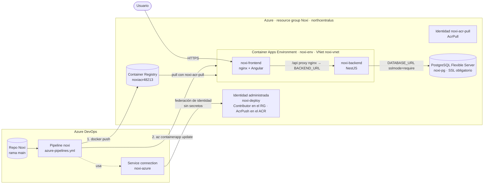

# Noxi — Gestión de solicitudes de crédito

- **Nombre completo:** MarcOS P1n3d4
- **Correo:** lc.mpineda@gmail.com
- **Usuario de GitHub:** dotforeach

Aplicación full stack para crear solicitudes de crédito, aprobarlas o rechazarlas (con comentario) y consultar su estado filtrando por estado.

## Tecnologías
| Capa | Tecnología |
|---|---|
| Backend | NestJS 12, TypeORM, class-validator, JWT (`@nestjs/jwt`) |
| Base de datos | PostgreSQL 16 |
| Frontend | Angular 22 (standalone, signals, formularios reactivos) |
| Infraestructura | Docker / docker compose |
| Documentación API | Swagger (`@nestjs/swagger`) |
| Tests | Vitest (backend y frontend) |

## Estructura
```
backend/              API REST (NestJS)
frontend/             SPA (Angular)
docker-compose.yml    db + backend + frontend
```

## Requisitos
| Para | Necesitas |
|---|---|
| Ejecutar con Docker (recomendado) | Docker 24+ con Compose v2 (`docker compose`) y los puertos 3000 y 4200 libres |
| Desarrollo local | Node.js 22+ (con npm 10+) y un PostgreSQL 16 propio |

## Ejecutar con Docker
```bash
./scripts/setup-env.sh     # crea .env con secretos aleatorios (o: cp .env.example .env y completarlo a mano)
docker compose up --build
```
En Windows, usar WSL o copiar `.env.example` a `.env` y completar los valores. El script no sobrescribe un `.env` existente.

- Web: http://localhost:4200 (crear una cuenta en `/registro`; cada persona se registra con su propio correo y contraseña)
- API: http://localhost:3000/api · documentación Swagger: http://localhost:3000/api/docs

| Variable | Descripción |
|---|---|
| `POSTGRES_USER`, `POSTGRES_PASSWORD`, `POSTGRES_DB` | Credenciales de la base de datos que levanta el compose |
| `JWT_SECRET` | Secreto para firmar los JWT |
| `JWT_EXPIRES_IN` | Vigencia del token (por defecto `1h`) |

No hay credenciales ni usuarios predefinidos en el repositorio: los secretos salen del `.env` (ignorado por git) y los usuarios se crean con el registro.

## Base de datos y migraciones
PostgreSQL local en Docker. El esquema se gestiona **solo con migraciones de TypeORM** (`backend/src/migrations`, `synchronize` está desactivado) y se aplican automáticamente al arrancar el backend. Para usar Supabase u otro Postgres, apuntar `DATABASE_URL` del backend a esa instancia.

```bash
cd backend
npm run migration:generate -- src/migrations/NombreCambio   # compara las entidades con la BD y genera la migración
npm run migration:run                                       # aplica las pendientes
npm run migration:revert                                    # revierte la última
```
El CLI lee `DATABASE_URL` de `backend/.env`.

## Desarrollo local (sin Docker)
El frontend llama a `/api`: en Docker lo reenvía nginx a `BACKEND_URL` (`frontend/nginx.conf.template`) y con `npm start` el dev server (`frontend/proxy.conf.json`) lo reenvía a `http://localhost:3000`.
```bash
# Backend (necesita un Postgres propio)
cd backend
cp .env.example .env      # completar DATABASE_URL, JWT_SECRET
npm install --legacy-peer-deps
npm run start:dev

# Frontend
cd frontend
npm install
npm start                 # http://localhost:4200
```
`--legacy-peer-deps` evita un fallo de resolución de dependencias de npm con NestJS 12.

## Tests
```bash
cd backend  && npm test
cd frontend && npm test -- --watch=false
```

## API
Todas las rutas (salvo login) requieren `Authorization: Bearer <token>`.

| Método y ruta | Descripción | Códigos |
|---|---|---|
| `POST /api/auth/register` | `{email, password (8–128)}` → `{accessToken}` | 201, 400, 409, 429 |
| `POST /api/auth/login` | `{email, password}` → `{accessToken}` | 200, 400, 401, 429 |
| `POST /api/credit-requests` | `{cedula, amount, termMonths}` | 201, 400, 401 |
| `GET /api/credit-requests?status=` | Lista; `status` = `PENDING`, `APPROVED` o `REJECTED` | 200, 400, 401 |
| `GET /api/credit-requests/:id` | Detalle | 200, 400, 401, 404 |
| `PATCH /api/credit-requests/:id/status` | `{status, comment}` (comentario obligatorio) | 200, 400, 401, 404, 409 |

Documentación interactiva (Swagger UI) en `/api/docs`; ahí se puede pegar el JWT con *Authorize*.

Reglas de negocio: monto entre $500 y $50,000 (hasta 2 decimales); plazo entero entre 6 y 60 meses; cédula panameña (`8-123-456`, `08-0123-004567`, `PE-1-234`, `E-8-12345`, `N-12-345`, `PI-5-678`; hasta 20 caracteres, se normaliza a mayúsculas). Una solicitud solo se puede resolver desde `PENDING`; intentar cambiar una ya aprobada o rechazada devuelve 409.

## Decisiones de diseño
- **Errores**: la API responde `{message, error, statusCode}` y el frontend muestra el `message` tal cual al usuario (validaciones, 409, sin conexión).
- **Contraseñas**: `scrypt` de Node con sal aleatoria y comparación en tiempo constante (sin dependencias nativas).
- **Login**: mismo error para correo o contraseña incorrectos, para no revelar qué usuarios existen.
- **Transiciones de estado** definidas en un solo lugar (`ALLOWED_TRANSITIONS`).
- **Límite de peticiones**: 100 por minuto y por IP en general y 10 por minuto en login/registro (`@nestjs/throttler`); al excederlo responde 429 con mensaje legible. Se oculta la cabecera `X-Powered-By`.
- **Sesión en el frontend**: el JWT se guarda en `localStorage`; un interceptor lo adjunta y cierra sesión ante un 401.
- **Validación doble**: el formulario replica los rangos del backend para dar feedback inmediato; el backend es la fuente de verdad.

## Despliegue en Azure (opcional)
Además del `docker compose` local, el proyecto se despliega en **Azure Container Apps** con un pipeline de **Azure DevOps** (`azure-pipelines.yml`). Es un extra: la prueba se ejecuta completa con Docker en local.

### Arquitectura


### Flujo del pipeline
1. **CI** (cada push o PR a `main`): lint, tests y build del backend; tests y build del frontend.
2. **Deploy** (solo `main`, entorno `noxi-prod`): `docker build` y `docker push` de ambas imágenes a Azure Container Registry con el número de build como tag, y `az containerapp update` en las dos apps.

### Decisiones
- **Sin secretos en el pipeline**: la service connection usa *Workload Identity Federation* con una identidad administrada (`noxi-deploy`), así que no hay contraseñas ni claves de servicio guardadas. Se eligió esta variante porque la cuenta no puede crear App Registrations en Entra ID.
- **Mínimo privilegio**: `noxi-deploy` es Contributor solo sobre el resource group `Noxi` y AcrPush sobre el registro; las apps descargan imágenes con otra identidad (`noxi-acr-pull`) que solo tiene AcrPull.
- **Imágenes con Docker en el agente** en lugar de `az acr build`, porque ACR Tasks está bloqueado en suscripciones Azure for Students.
- **Mismo origen**: el frontend llama a `/api` y nginx lo reenvía a `BACKEND_URL`, por lo que el navegador no hace peticiones entre orígenes y no hay URLs del backend en el código.
- **Secretos de runtime** (`DATABASE_URL`, `JWT_SECRET`) como *secrets* de la Container App; la base de datos exige SSL y su firewall solo admite servicios de Azure.
- **Migraciones** automáticas al arrancar el backend (`migrationsRun`).

### Aprovisionar la infraestructura
`scripts/azure-provision.sh` crea el PostgreSQL y las dos Container Apps sobre el resource group, el registro y el entorno ya existentes (ver las variables al inicio del script). Requiere `az login` y un `JWT_SECRET` en `.env`. Después hay que crear en Azure DevOps la service connection `noxi-azure` y un pipeline que apunte a `azure-pipelines.yml`.
